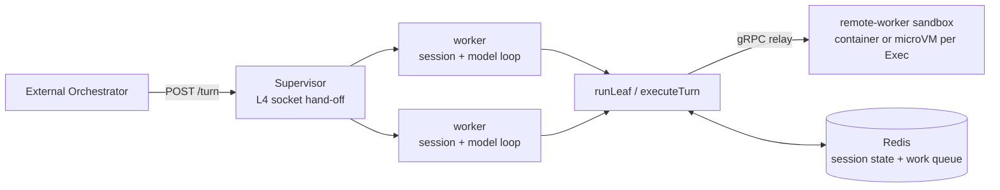

# MOCA — Micro Orchestrator for Cloud Agents

**Run stateful AI coding agents on a dense, warm process-manager runtime — sessions resume exactly where they left off.**

-success>)


MOCA runs long-lived AI agents as **warm, dense sessions on a process-manager runtime (P6)**. An
agent process normally has to stay resident — holding its conversation, tool state, and working
directory in memory — while it waits for the next turn or for a human to approve a step. MOCA
decouples the agent's **state** (durable in Redis) and its **tool execution** (an isolated remote
sandbox — a container, or a Firecracker microVM per `Exec`) from the **agent process** itself, so
one supervisor hands connections to a fixed pool of warm workers: many sessions per worker, no
cold-start on the next request.

Capacity scales the boring way: **add process-manager pods, or size them up** — on a VM, bare
metal, or plain Kubernetes. The earlier scale-to-zero Knative + KEDA deployment is deprecated
([ADR-0041](docs/adrs/0041-deprecate-knative-keda-deployment.md)); see
[Migrating off the Knative/KEDA deployment](docs/migrating-from-knative.md).

The result is a **leaf-session backend**: an external orchestrator dispatches isolated units of
agent work ("leaves") over a simple HTTP + shared-volume contract — sync turns, detachable
streaming turns, and human-gated runs, with async fan-out and scheduled dispatch owed P6
follow-ups ([ADR-0034](docs/adrs/0034-vm-process-manager-socket-handoff.md)).

## Table of Contents

- [Why](#why)
- [Architecture](#architecture)
- [Features](#features)
- [Quick Start](#quick-start)
- [Legacy: Knative + KEDA deployment](#legacy-the-knative--keda-deployment-deprecated)
- [How It Works](#how-it-works)
- [Dispatch Archetypes](#dispatch-archetypes)
- [Repository Layout](#repository-layout)
- [Evidence](#evidence)
- [Roadmap](#roadmap)
- [Documentation](#documentation)
- [Status & License](#status--license)

---

## Why

| Persistent agent                                    | MOCA                                                                |
| --------------------------------------------------- | ------------------------------------------------------------------- |
| Process stays resident between turns                | Warm worker pool — many sessions per worker, no cold-start          |
| State lives in process memory — lost on crash/evict | State lives in **Redis** — survives eviction, restart, and resume   |
| Tools execute in the agent process                  | Tools execute in an **isolated remote sandbox** (brain/hands split) |
| One process per session                             | Many sessions per worker; scale by **adding pods or sizing up**     |
| One invocation model                                | Sync, detachable streaming, human-gated                             |

The economics measurement ([experiment](https://github.com/rossoctl/moca-experiments/blob/main/knative/EXPERIMENTS.md),
run on the now-deprecated scale-to-zero path) showed the serverless shape consuming roughly a
quarter of the pod-seconds of an always-on agent. P6 trades scale-to-zero for density — many
sessions per worker with admission control — and keeps what that experiment bought on the
latency side: no autoscaler cold-start between turns.

---

## Architecture



| Component                 | Role                                                                                                                                                                                                                                                         |
| ------------------------- | ------------------------------------------------------------------------------------------------------------------------------------------------------------------------------------------------------------------------------------------------------------ |
| **Supervisor**            | L4-only listener; hands each accepted socket to a warm worker and never touches a response byte ([ADR-0034](docs/adrs/0034-vm-process-manager-socket-handoff.md))                                                                                            |
| **Worker pool**           | Fixed set of forked workers; many sessions per worker, bounded concurrent turns, admission control instead of autoscaling                                                                                                                                    |
| **Redis**                 | Durable session state (resume by `sessionId`), work queue (Streams), gate state                                                                                                                                                                              |
| **remote-worker sandbox** | Tool/code execution in a container — or a Firecracker microVM per `Exec` ([ADR-0035](docs/adrs/0035-per-exec-microvm-warm-standby.md)) — dialed in over the gRPC relay ([ADR-0024](docs/adrs/0024-sandbox-transport-remote-exec.md)); needs no inbound route |
| **Control plane**         | Multi-user identity and credentials (MU1); issues per-session tokens ([ADR-0033](docs/adrs/0033-multi-user-control-plane.md))                                                                                                                                |

> **Note:** The supervisor and its workers are the **same container image**: the supervisor forks
> `packages/knative-server/src/worker.ts` (the package name is historical — the code is
> P6-load-bearing). The "brain" (model inference + session logic) runs in a worker; the "hands"
> (command/tool execution) always run in the sandbox.

---

## Features

- **Warm, dense sessions** — a fixed worker pool serves many sessions each; no activator
  cold-start between turns, and capacity scales with pods, not autoscalers.
- **Durable resume** — sessions are append-only logs in Redis; a restarted worker recalls full
  conversation and state by `sessionId`, surviving process or pod death.
- **Brain/hands isolation** — the agent never executes tools in its own process; everything runs
  in a remote sandbox over the gRPC relay — container tier, or a microVM per `Exec`.
- **Human-in-the-loop gates** — a leaf can pause mid-run, report `awaiting_approval`, and resume on an
  external approve/reject/abort verdict.
- **Volume-envelope contract** — orchestrators pass inputs and collect results as files, decoupling
  result size from HTTP limits.
- **Hardened by default** — non-root, read-only root filesystem, dropped capabilities where the
  substrate allows; isolation is enforced by the sandbox tier, not by trust.
- **Built on Pi** — wraps a pinned [`kagenti/pi`](https://github.com/kagenti/pi) coding agent through
  an injectable `SessionStorageBackend` seam; the agent itself is unmodified.
- **Promote a local Claude Code workflow** — `cd harness && pnpm promote` bundles skills, `CLAUDE.md`,
  memory, and a slash command from your local `~/.claude` into a content-addressed bundle a leaf can
  dispatch by digest (see [Promoting a local Claude Code workflow](#promoting-a-local-claude-code-workflow)).

---

## Quick Start

Try the P6 runtime in five minutes, no root, with Docker Compose — the supervisor, the relay,
Redis and a sandbox on one machine:

> **Prerequisites:** `docker` (or a compatible runtime) and an Anthropic-compatible model
> credential.

```bash
git clone --recurse-submodules https://github.com/rossoctl/moca.git
cd moca
./deploy/compose/install.sh
```

Where to go next:

- **Production, a dedicated VM or bare metal:** [`deploy/vm/`](deploy/vm/README.md) — `setup-vm.sh`,
  systemd units, podman `isolate=strict` + nftables.
- **Stay on Kubernetes or OpenShift:** [`deploy/k8s/`](deploy/k8s/README.md) — the same P6 process
  model as ordinary cluster workloads (`setup.sh`, with Kind and OCP overlays).
- **Guided tour:** [`docs/demos/vm-multi-user-demo.md`](docs/demos/vm-multi-user-demo.md) — two
  users, one VM, two sandbox tiers (~40 min). All demos are indexed in
  [`docs/demos/`](docs/demos/).

---

## Legacy: the Knative + KEDA deployment (deprecated)

The original scale-to-zero deployment — Knative Service, KEDA ScaledJobs, `kubectl exec` sandboxes
under [`deploy/knative/`](deploy/knative/) — is **deprecated as of 2026-10-11**
([ADR-0041](docs/adrs/0041-deprecate-knative-keda-deployment.md)). It receives security and
breakage fixes only; removal comes no earlier than **end of October 2026**, once the remaining
users have migrated. See [Migrating off the Knative/KEDA
deployment](docs/migrating-from-knative.md) for what maps to what. Its setup scripts
(`setup-kind.sh`, `setup-ocp.sh`), guides and smoke record
([`deploy/knative/SMOKE.md`](deploy/knative/SMOKE.md)) remain in-tree and working until removal.

---

## How It Works

1. **An orchestrator POSTs a turn** to `/turn` (or a leaf to `/runs`).
2. The **supervisor** accepts the connection and hands the socket to a warm **worker** — it never
   touches a response byte.
3. The worker runs the model loop; every tool call executes in a **remote sandbox** over the gRPC
   relay — container tier, or a microVM per `Exec`.
4. **Session state streams to Redis** as it goes, so the turn is resumable by `sessionId` even if
   the worker dies mid-run.
5. Capacity scales by **adding process-manager pods or sizing them up**; admission control
   (bounded concurrent turns per worker) replaces autoscaling.

---

### Promoting a local Claude Code workflow

Iterate on a workflow locally in Claude Code — skills, `CLAUDE.md`, memory, a slash command — then
promote it from inside Claude Code, in the project you want to promote:

```bash
mkdir -p ~/.claude/commands                                    # once
cp deploy/claude/commands/promote.md ~/.claude/commands/       # once
export SH_HARNESS_DIR=/path/to/moca              # once, per shell

# launch with the CLI granted at session level, so the grant outlives the command's own turn
claude --allowedTools "Bash(pnpm --dir $SH_HARNESS_DIR/harness promote:*)"

/promote my-workflow                                           # in any project, from Claude Code
```

The command's `allowed-tools` frontmatter grants the CLI for the turn the slash command creates. That
is enough when the promotion completes in that turn; if the turn ends first — an interruption, or a
guard that stops to ask — the grant is gone and the next turn's `pnpm` call is refused, since a
default install has no `pnpm` rule. The launch flag above avoids that, stays narrow (only the
`promote` script, only in that checkout), and needs no change to your settings. The equivalent
permanent form is the same rule in `permissions.allow`, with the path written out — a `*` inside the
pattern matches nothing.

`/promote` passes `--home` and `--project` for you, checks that the repo boundary and the Redis
tunnel are right before uploading, and reads the digest back through the cluster's own client
afterwards. It writes every path out in full, with no `$VAR` and no `HOME=… pnpm …` prefix, because
Claude Code will only match a command against `allowed-tools` if it can analyse it statically —
otherwise the command needs a permission prompt at best, and under `defaultMode: dontAsk` or `auto`
it is refused outright.

Installed in your **real** `~/.claude/commands/` as above, it is visible in every project and never
travels. You can instead keep it **in the project**, which lets you run Claude Code with
`HOME=<project>` so the local agent sees exactly what the promoted run will; `/promote` then detects
that it lives there and self-excludes with `--exclude-prompt promote` (see below), because otherwise
it would ship itself into every bundle.

Or drive the CLI directly:

```bash
cd harness && pnpm promote --entry my-workflow --project /path/to/your/project
```

`promote` reads the workflow — skills, `CLAUDE.md` chain, and memory — from `--project`, so
running it from the harness checkout without `--project` promotes the harness's own
configuration, not yours.

`--home <dir>` reads _user_ scope (skills, memory, prompts) from `<dir>/.claude` instead of your real
`$HOME`, and `--redis-url <url>` names the Redis to upload to. Both override the corresponding env
var (`HOME`, `REDIS_URL`) and produce a byte-identical bundle to it; they exist as flags so the whole
invocation can be one statically analyzable command, which is what `/promote` needs to run without a
permission prompt. The CLI prints the user scope it resolved, so you can see which one applied.

`promote` dedupes and classifies your local configuration, drops what cannot work in the harness
(with a reason for each), and scans for credentials before uploading. The scan has two tiers: a
structural match on a known key shape (an AWS access key, a PEM private-key block, a GitHub or
Slack token, an OpenAI-style key) **refuses the upload** and exits non-zero; a weaker prose
heuristic (`token: <value>`-shaped lines) only **warns and proceeds**, leaving the judgement to
you — that heuristic matches code and documentation placeholders too often to block on safely. It
writes a committable `.claude/promoted.lock.json` and uploads a content-addressed bundle; an
unchanged re-promotion uploads nothing.

Keep a prompt out of the bundle with `--exclude-prompt <name>`, repeatable. This exists for the
case where the command that _drives_ promotion lives in the project being promoted: with user scope
pointed at that project, its `.claude/commands/` is the prompts directory, so without the flag such
a command ships itself into every bundle. Excluding the entry prompt is refused outright, and an
exclusion that matches nothing warns — an unmatched exclusion would otherwise ship the prompt you
meant to omit.

Dispatch it by adding one field to any prompt leaf:

```json
{ "sessionId": "run-1/item-1", "kind": "prompt", "prompt": "…", "configRef": "sha256:…" }
```

Memory travels **read-only** — a promoted run consumes what you taught it locally and reports
discoveries back in the leaf result, which keeps leaf replay reproducible
([ADR-0031](docs/adrs/0031-promoted-memory-read-only.md)). MCP servers and subagents are not
promoted; see the [design](docs/specs/2026-09-02-claude-code-workflow-promotion-design.md) §2, §9.

---

## Dispatch Archetypes

The same backend serves three orchestration patterns, all validated end-to-end on Kind:

| Archetype             | Pattern                                                                                | Example use case                                     |
| --------------------- | -------------------------------------------------------------------------------------- | ---------------------------------------------------- |
| **A — Async fan-out** | `{async:true}` → Redis Streams → drained by KEDA ScaledJobs — **deprecated path only** | "Research 10 topics concurrently"                    |
| **B — Human gate**    | Leaf pauses → `awaiting_approval` → external verdict → resume/terminate                | "Draft a clause, pause for legal sign-off, finalize" |
| **C — Scheduled**     | CronJob → `cron-dispatch` posts async leaves — **deprecated path only**                | "Summarize yesterday's tickets at 02:00 daily"       |

B is served by the P6 runtime today. A and C have **no P6 equivalent yet** — the async drainer
and the scheduled on-ramp are owed follow-ups flagged in
[ADR-0034](docs/adrs/0034-vm-process-manager-socket-handoff.md) and
[ADR-0041](docs/adrs/0041-deprecate-knative-keda-deployment.md); they work only on the deprecated
Knative/KEDA path.

---

## Repository Layout

```text
moca/
├── harness/               # Pi SessionStorageBackend adapter (write-behind) + promote CLI
├── packages/
│   ├── supervisor/        # P6 process manager: L4 listener, socket hand-off, worker pool
│   ├── knative-server/    # HTTP server + P6 worker entry points (name is historical)
│   ├── k8s-sandbox/       # Sandbox transports (K8s pod-exec half deprecated, ADR-0041)
│   ├── session-backend/   # Generic append-only LogStore + Redis Streams impl
│   ├── work-queue/        # Redis Streams work queue (async dispatch)
│   ├── sandbox-relay/     # gRPC relay between control plane and remote-worker sandboxes
│   ├── control-plane/     # Multi-user control plane, credential issuance
│   └── mocactl/           # MOCA terminal client for the control plane
├── remote-worker/         # Go: container + microVM sandbox workers
├── deploy/
│   ├── vm/                # P6 single-VM systemd deployment (production)
│   ├── k8s/               # P6 on Kubernetes/OpenShift (first-class)
│   ├── compose/           # Docker Compose trial of the P6 runtime
│   ├── microvm/           # P4 Firecracker microVM deployment
│   └── knative/           # Knative/KEDA deployment — DEPRECATED (ADR-0041)
├── pi-fork/               # Pinned Pi coding agent (submodule)
└── docs/                  # Specs, ADRs, demos, migration guide
```

---

## Evidence

Behaviour and economics are backed by reproducible experiments rather than claims:

- **[`moca-experiments/knative/EXPERIMENTS.md`](https://github.com/rossoctl/moca-experiments/blob/main/knative/EXPERIMENTS.md)**
  — cluster experiments E1 (economics), E3 (mobility), E4 (recovery), run live on Kind. Moved to
  a separate repo 2026-09-25 (see `docs/specs/2026-09-24-ra1-density-cutover-and-repo-rearchitecture-design.md`).
- **[`docs/experiment-results.md`](docs/experiment-results.md)** — E2 (reconstruction cost) and E5
  (budget enforcement); the `@sh/experiments` workspace these ran from moved to
  [`moca-experiments/experiments/`](https://github.com/rossoctl/moca-experiments/tree/main/experiments)
  on 2026-09-25 (see `docs/specs/2026-09-24-ra1-density-cutover-and-repo-rearchitecture-design.md`).
- **[`deploy/knative/SMOKE.md`](deploy/knative/SMOKE.md)** — the deprecated Knative path's 6/6
  cold-start + resume smoke record.

---

## Roadmap

**Phase 1 — Decoupled Harness (built):** Redis session backend, remote sandbox client, persistent
in-pod channel, Knative wrapper, compaction-checkpoint fast path, experiments, and the leaf-session
backend with all three dispatch archetypes. See the
[milestone registry](docs/specs/README.md) for the source-of-truth status of every milestone.

**Phase 2 — Zero-Trust Credential Plane (design complete, deferred):** a credential plane where
_no component influenced by model output ever holds a raw secret._

| ID  | Adds                                                                  |
| --- | --------------------------------------------------------------------- |
| Z1  | Per-session SPIFFE identity (SPIRE)                                   |
| Z2  | Secret-free, default-deny harness lock-down                           |
| Z3  | Inference injector — provider-key chokepoint, mTLS to the LLM gateway |
| Z4  | MCP code-mode in the sandbox                                          |
| Z5  | Generalized credentialed egress (sandbox forward proxy)               |
| Z6  | Subagents as isolated child sessions                                  |
| Z7  | Red-team + formal validation of the credential plane                  |

Today the harness uses a trust-the-operator model: the model credential is a pre-provisioned
Kubernetes Secret, there is no egress policy, and all leaves share one service-account identity. Those
gaps are exactly what Phase 2 closes.

---

## Documentation

- [Glossary](docs/glossary.md) — canonical `session`/`turn` vocabulary; why `run` isn't a harness concept
- [Migrating off the Knative/KEDA deployment](docs/migrating-from-knative.md) — deprecation policy and destination map
- [Deploy: VM](deploy/vm/README.md) · [Kubernetes/OpenShift](deploy/k8s/README.md) · [Compose trial](deploy/compose/README.md)
- [Executive overview — leaf-session backend](docs/executive-overview-leaf-session.md)
- [Milestone registry](docs/specs/README.md) — authoritative milestone numbering and status
- [Design specs](docs/specs/) — one dated design doc per milestone
- [`harness/README.md`](harness/README.md) — local dev build (Pi workspace build order, headless smoke)

---

## Status & License

This is explorative work. The warm-worker-pool runtime, durable resume, sandbox isolation
(container and microVM tiers), and the multi-user control plane are built; async fan-out and
scheduled dispatch on P6, and the zero-trust credential plane, are designed but not yet
implemented. Interfaces may change.

Licensed under the [Apache License 2.0](LICENSE).
